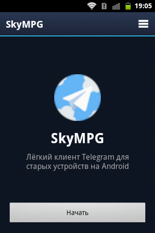
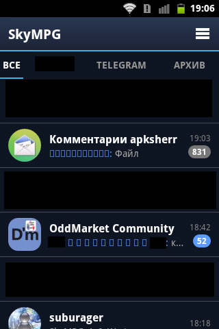
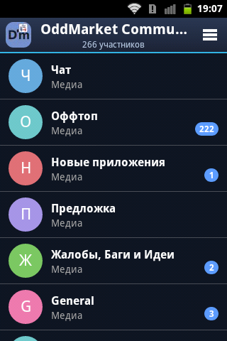
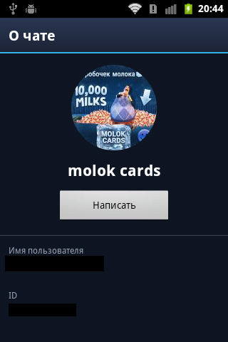
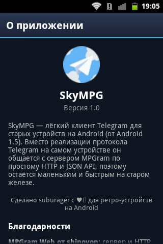

# SkyMPG

**English** | [Русский](README.ru.md)

A lightweight Telegram client for old Android devices, from Android 1.5 up. Instead of implementing the Telegram protocol on the phone, SkyMPG talks to an [MPGram](https://github.com/shinovon/mpgram-web) server over plain HTTP and a JSON API. That keeps it small and fast on old hardware.

## Screenshots

<p align="center">
  
  
  
</p>

<p align="center">
  
  
  
</p>

## Features

- **Chat list** with avatars, last messages, and unread counters
- **Folders** and the archive, shown as tabs above the chat list
- **Three interface languages:** Russian, Ukrainian, and English
- **Sending attachments:** photos, videos, and files, several at once, with an optional caption
- **Message actions:** reply, edit, copy, delete, and pin messages
- **Passcode lock** to protect the app with a PIN
- **Emoji:** an emoji picker with recent and categorized tabs; emoji are shown as images
- **Forum topics** in group chats
- **Downloading attachments**, one file or all of them at once
- **Photo viewer** with pinch-to-zoom, panning, and saving to the device
- **Reactions:** shown as counts only, because the MPGram API does not provide who reacted
- **Pinned messages:** a banner above the chat that cycles through all pinned messages
- **And more:** sending and receiving messages, live updates with a typing indicator, and a list cache so chats open quickly on slow devices

## Download

### Primary download

Built and signed by the author. These are the only builds I vouch for.

- **GitHub Releases:** [latest release](https://github.com/suburager/skympg/releases/latest), file `SkyMPG-1.0-RELEASE.apk`
- **4PDA:** (https://4pda.to/forum/index.php?showtopic=1129537)

Verify the file against the SHA-256 checksum published in the release notes:

```
sha256sum SkyMPG-1.0-RELEASE.apk
```

### Mirrors

These sites host copies of SkyMPG for convenience. I do not control them and cannot guarantee that the files are unchanged, so check the checksum above before installing.

| Source | Link |
|---|---|
| [...] | [...] |

If a mirror site contains a file with a checksum that does not match the one for the official release, do not install it under any circumstances. It could contain absolutely anything.

## Build

Requirements: JDK 21, Android SDK (platform 34, build-tools 34.0.0), Gradle 8.10.2.

Set the SDK location with the `ANDROID_HOME` variable or create `local.properties` in the project root:

```
sdk.dir=/path/to/android-sdk
```

Then run:

```
gradle assembleDebug
```

The APK will be at `app/build/outputs/apk/debug/app-debug.apk`.

To build and install over an existing version in one step (requires `adb` in `PATH`):

```
gradle reinstall
```

## Updating over an old version

Your data and login are kept when all three conditions hold:

1. Install with `-r`: `adb install -r app-debug.apk`, or use `gradle reinstall`. Without it, adb reports `INSTALL_FAILED_ALREADY_EXISTS`.
2. `versionCode` is not lower than the installed one. It grows with every build.
3. The signing key is the same. Debug builds use `~/.android/debug.keystore`, so build on the same machine or copy that file. Otherwise you will get `INSTALL_FAILED_UPDATE_INCOMPATIBLE`, and the only fix is uninstalling the old version first.

## Development notes

- minSdk is 3 (Android 1.5). Do not use AndroidX or AppCompat, lambdas, `String.isEmpty()`, `Build.VERSION.SDK_INT`, `match_parent` (use `fill_parent`), or `Activity.onBackPressed()`.
- HTTPS usually fails on Android 1.x and 2.x because of old TLS and certificates. Use an instance that serves plain HTTP.
- The version shown in "About" and sent in the `X-mpgram-app-version` header comes from `versionName` in `app/build.gradle`. Bump `versionCode` and `versionName` for every build.

## Credits

- [MPGram Web](https://github.com/shinovon/mpgram-web) by shinovon (AGPL-3.0), the server SkyMPG talks to
- [MadelineProto](https://github.com/danog/MadelineProto) by Daniil Gentili (AGPL-3.0)

Full license texts are also available inside the app under "About".

## License

SkyMPG is licensed under the [GNU GPL v3](LICENSE).
