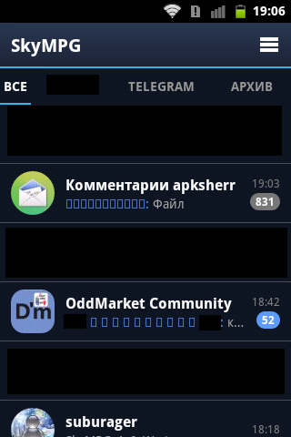
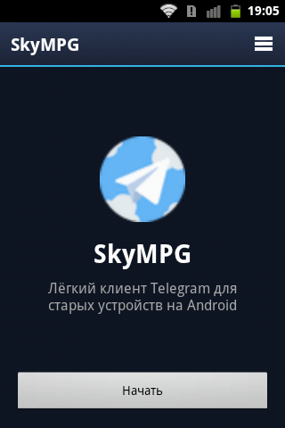
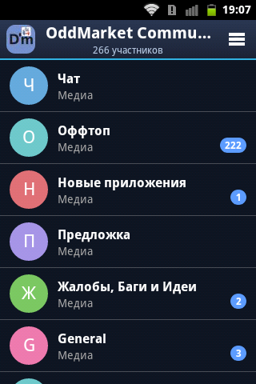
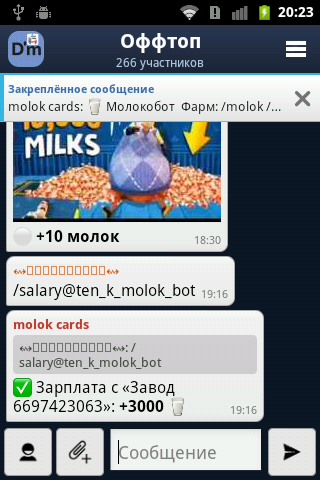
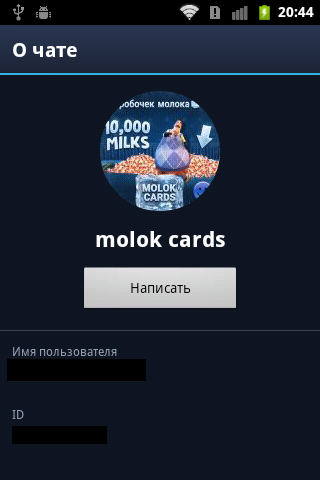
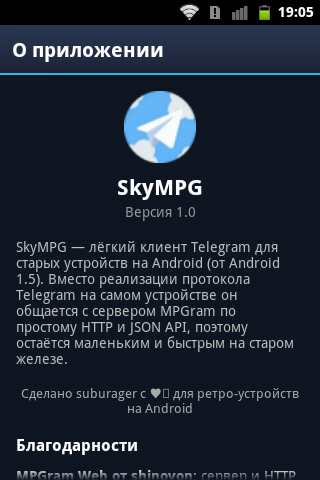

# SkyMPG

[English](README.md) | **Русский**

Лёгкий клиент Telegram для старых Android-устройств, от Android 1.5. Вместо реализации протокола Telegram на самом телефоне SkyMPG общается с сервером [MPGram](https://github.com/shinovon/mpgram-web) по простому HTTP и JSON API. Поэтому он остаётся маленьким и быстрым на старом железе.

<p align="center">
  
</p>

## Скриншоты

<p align="center">
  
  
  
</p>

<p align="center">
  
  
  
</p>

## Возможности

- **Список чатов** с аватарками, последними сообщениями и счётчиками непрочитанных
- **Папки** и архив: вкладками над списком чатов
- **Три языка интерфейса:** русский, украинский и английский
- **Отправка вложений:** фото, видео и файлы, сразу несколько, с необязательной подписью
- **Действия с сообщениями:** ответ, редактирование, копирование, удаление и закрепление
- **Пин-код** на приложение
- **Эмодзи:** панель выбора с недавними и разделёнными по категориям вкладками; эмодзи показываются картинками
- **Топики** в групповых чатах
- **Скачивание вложений:** по одному файлу или все сразу
- **Просмотрщик фото** с масштабированием щипком, перемещением и сохранением на устройство
- **Реакции:** показывается только их число, так как API MPGram не сообщает, кто поставил реакцию
- **Закреплённые сообщения:** плашка над чатом, которая листает все закреплённые сообщения
- **И многое другое:** отправка и получение сообщений, обновления в реальном времени с индикатором «печатает» и кэш списка, чтобы чаты быстро открывались на слабых устройствах

## Скачать

### Основной источник

Собирается и подписывается автором. Только эти сборки я могу гарантировать.

- **GitHub Releases:** [последний релиз](https://github.com/suburager/skympg/releases/latest), файл `skympg.apk`

Проверьте файл по SHA-256, который указан в описании релиза:

```
sha256sum skympg.apk
```

### Зеркала

Эти сайты размещают копии SkyMPG для удобства. Я ими не управляю и не могу гарантировать, что файлы не изменены, поэтому перед установкой сверьте контрольную сумму, указанную выше.

| Источник | Ссылка |
|---|---|
| [Название зеркала] | [Ссылка на зеркало] |

Если у зеркала файл с контрольной суммой, которая не совпадает с основным релизом, не устанавливайте его и, пожалуйста, создайте issue.

## Сборка

Нужны: JDK 21, Android SDK (platform 34, build-tools 34.0.0), Gradle 8.10.2.

Укажите путь к SDK через переменную `ANDROID_HOME` или создайте `local.properties` в корне проекта:

```
sdk.dir=/путь/к/android-sdk
```

Затем выполните:

```
gradle assembleDebug
```

APK появится в `app/build/outputs/apk/debug/app-debug.apk`.

Чтобы собрать и сразу поставить поверх установленной версии (нужен `adb` в `PATH`):

```
gradle reinstall
```

## Обновление поверх старой версии

Данные и вход в аккаунт сохраняются, если одновременно выполняются три условия:

1. Установка с ключом `-r`: `adb install -r app-debug.apk` или `gradle reinstall`. Без него adb выдаёт `INSTALL_FAILED_ALREADY_EXISTS`.
2. `versionCode` не меньше установленного. Он растёт с каждой сборкой.
3. Подпись та же. Debug-ключ лежит в `~/.android/debug.keystore`, поэтому собирайте на одной машине или копируйте этот файл. Иначе будет `INSTALL_FAILED_UPDATE_INCOMPATIBLE`, и помогает только удаление старой версии.

## Заметки для разработки

- minSdk: 3 (Android 1.5). Не используйте AndroidX, AppCompat, лямбды, `String.isEmpty()`, `Build.VERSION.SDK_INT`, `match_parent` (только `fill_parent`), `Activity.onBackPressed()`.
- HTTPS на Android 1.x и 2.x обычно не работает из-за старого TLS и сертификатов. Используйте инстанс, который отдаёт обычный HTTP.
- Версия в «О приложении» и в заголовке `X-mpgram-app-version` берётся из `versionName` в `app/build.gradle`. Поднимайте `versionCode` и `versionName` в каждой новой сборке.

## Благодарности

- [MPGram Web](https://github.com/shinovon/mpgram-web) от shinovon (AGPL-3.0), сервер, с которым общается SkyMPG
- [MadelineProto](https://github.com/danog/MadelineProto) от Daniil Gentili (AGPL-3.0)

Полные тексты лицензий также доступны в приложении в разделе «О приложении».

## Лицензия

SkyMPG распространяется под лицензией [GNU GPL v3](LICENSE).
